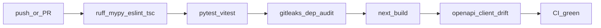

# Contributing to DealerIQ

Thanks for contributing. This project is a spec-driven monorepo with a high quality bar
(constitution in `docs/constitution.md`).

## Quick loop

```bash
make bootstrap && make seed && make dev   # first time
make lint && make test                   # before every PR
make ci                                  # full local CI parity when touching contracts
```

## Branch and PR

1. Branch from `main` with a short descriptive name (`docs/portal`, `fix/...`).
2. Keep PRs focused; separate refactors from behavior changes when possible.
3. PR description: **why**, how to test, link SRS/ADR IDs if relevant.
4. CI (`.github/workflows/ci.yml`) must be green: lint, tests, Next build, OpenAPI client drift,
   gitleaks, dependency audit.

### CI pipeline diagram

**Purpose:** Gates that must pass before merge (`make ci` / GitHub Actions). See also
[diagrams D17](docs/diagrams/README.md#d17-ci-pipeline).



## Commit messages

Prefer [Conventional Commits](https://www.conventionalcommits.org/):
`feat:`, `fix:`, `docs:`, `refactor:`, `test:`, `chore:`.

## When to write an ADR

Any change to stack, security model, persistence policy, monorepo layout, or analytics
scientific gates needs an ADR under `docs/adr/` **before** or **with** the code (Principle I).

## Specs vs docs

| Path | Use for |
|------|---------|
| `specs/` | Planning a new delivery phase (spec/plan/tasks) |
| `docs/` | Durable product truth (portal, SRS, ADRs, runbooks) |

Do not treat `specs/` as the live system description after merge.

## API / frontend contract

- Change FastAPI routes/schemas → regenerate client (`docs/how-to/regenerate-api-client.md`).
- Frontend must use `@dealeriq/api-client` only (no ad-hoc undocumented fetch).

## Security

See [`SECURITY.md`](SECURITY.md). Never commit secrets. Use waivers in
`security/dependency-waivers.json` only with rationale and re-review dates.

Two audit gates run in pre-commit and CI, both waiver-aware:

- `scripts/ci/check_dependency_audit.py` cross-references pip-audit and npm audit against
  `security/dependency-waivers.json`.
- `scripts/ci/check_identity_strings.py` keeps local home paths, personal email addresses,
  LAN hostnames and private IPs out of the repository. It matches on shape, not on literal
  values, so `security/identity-policy.json` never has to contain the strings it rejects.

## Documentation

Update the Diataxis portal (`docs/README.md`) when adding operator-facing behavior. Refresh
`docs/reference/openapi.json` via `make docs-openapi` when the public API changes.

## Writing style

Keep punctuation plain ASCII: no em dashes, en dashes, curly quotes or ellipsis characters.
Headings are sentence case. Bold marks a term being defined, not every noun in a list.

Generated and historical files are out of scope: `CHANGELOG.md`, `LICENSE`, `SECURITY.md`,
`docs/paper/results/`, `docs/paper/references.bib`, `docs-app/src/generated/`, and anything under `apps/web/public/handbook/`.

## Attribution

The maintainer's name belongs only in the files listed under `identity.allowed_in` in
`security/identity-policy.json`: `LICENSE`, `CITATION.cff`, the SRS header, the paper byline,
and package metadata. The identity gate rejects it anywhere else, so put a byline in one of
those files rather than in a source comment or a runbook.

Package metadata carries the name without an address, on purpose. `SECURITY.md` routes
vulnerability reports through the GitHub profile instead of publishing an inbox.

