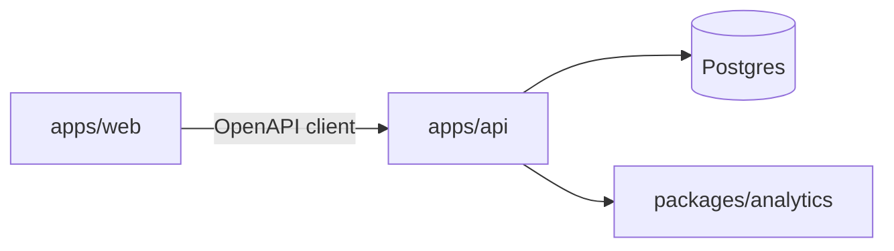

# DealerIQ

A dealership intelligence platform: automated demand forecasting, inventory optimization,
anomaly detection, customer/lead analytics, and rule-based alerting on top of a role-based
sales-and-inventory system of record.

| | |
|---|---|
| Spec | [`docs/srs/DealerIQ-SRS.md`](docs/srs/DealerIQ-SRS.md) (DIQ-SRS-001 v1.0.0) |
| Docs portal | [`docs/README.md`](docs/README.md) (Diataxis) |
| Handbook | `make docs` · reading path [`docs/00-reading-path.md`](docs/00-reading-path.md) · `/handbook/` after `make docs-site` |
| Diagrams | [`docs/diagrams/README.md`](docs/diagrams/README.md) (Mermaid D01-D18) |
| License | [MIT](LICENSE) |
| Security | [`SECURITY.md`](SECURITY.md) |
| Contributing | [`CONTRIBUTING.md`](CONTRIBUTING.md) |

## Stack

FastAPI (Python 3.12) · Next.js 15 (TypeScript, App Router) · PostgreSQL 16 · APScheduler ·
statsforecast / statsmodels (STL) / scikit-learn · Recharts. Local stack via Docker Compose
(Postgres + MailHog). Architecture decisions: [`docs/adr/`](docs/adr/).



## Repository layout

```
apps/api/              FastAPI — auth, RBAC, domain, jobs, OpenAPI
apps/web/              Next.js — app routes + features/
packages/analytics/    Forecasting, inventory intel, anomalies, scoring
packages/api-client/   Generated TypeScript client
infra/                 Compose, Dockerfile, seed generator
scripts/ops|ci/        Backup/restore and CI gates
deploy/                systemd backup units
docs/                  Documentation portal (start at docs/README.md)
docs/diagrams/         Mermaid visual catalog (architecture, auth, ops, CI)
docs-app/              Offline handbook reader (Vite); publishes to apps/web/public/handbook
specs/                 Planning archive
```

## Quick start

```bash
make bootstrap && make seed && make dev
```

- Web: http://localhost:3000  
- API docs: http://localhost:8000/api/v1/docs  
- MailHog: http://localhost:8025  

Seed logins and troubleshooting: [`docs/runbooks/local-dev.md`](docs/runbooks/local-dev.md).  
Full onboarding: [`docs/getting-started/onboarding.md`](docs/getting-started/onboarding.md).

## Handbook

```bash
make docs          # interactive reader at http://localhost:5178
make docs-verify   # corpus audit (CI gate)
make docs-site     # static build → apps/web/public/handbook/ (/handbook/)
```

## Quality

```bash
make lint && make test   # day-to-day
make ci                  # lint, tests, audit, Next build, client drift check
```

## Governance

- Constitution: [`docs/constitution.md`](docs/constitution.md)
- ADRs: [`docs/adr/`](docs/adr/) ([index](docs/adr/README.md))
- Deferred work: [`docs/backlog.md`](docs/backlog.md)
- Changelog: [`CHANGELOG.md`](CHANGELOG.md)
