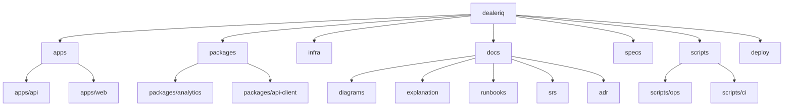
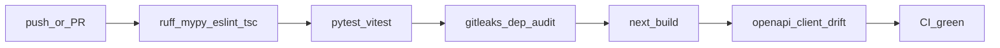

# Visual documentation catalog

**Audience:** engineers, operators, reviewers.  
**Last updated:** 2026-07-17  
**Format:** Mermaid embedded in Markdown (renders on GitHub / Cursor). No separate PNG/SVG assets.

Canonical diagrams live **inline** on the topic page that owns them. This catalog indexes every
diagram (D01–D18) with a deep link.

| ID | Type | Title | Location |
|----|------|-------|----------|
| D01 | flowchart | System context | [architecture § Context](../explanation/architecture.md#d01-system-context) |
| D02 | flowchart | Containers | [architecture § Containers](../explanation/architecture.md#d02-containers) |
| D03 | flowchart | API component layers | [architecture § API](../explanation/architecture.md#d03-api-component-layers) |
| D04 | flowchart | Web layers | [architecture § Web](../explanation/architecture.md#d04-web-layers) |
| D05 | flowchart | Production deployment | [production-deploy](../runbooks/production-deploy.md#d05-production-deployment) |
| D06 | flowchart | Local development topology | [local-dev](../runbooks/local-dev.md#d06-local-development-topology) |
| D07 | sequenceDiagram | Login and authenticated request | [security-model § Auth flow](../explanation/security-model.md#d07-login-and-authenticated-request) |
| D08 | sequenceDiagram | Refresh rotation and reuse detection | [security-model § Refresh](../explanation/security-model.md#d08-refresh-token-rotation-and-reuse-detection) |
| D09 | flowchart | RBAC deny-by-default | [security-model § RBAC](../explanation/security-model.md#d09-rbac-deny-by-default) |
| D10 | stateDiagram-v2 | Order lifecycle | [domain-lifecycles § Orders](../explanation/domain-lifecycles.md#d10-order-lifecycle) |
| D11 | stateDiagram-v2 | Lead funnel | [domain-lifecycles § Leads](../explanation/domain-lifecycles.md#d11-lead-funnel) |
| D12 | stateDiagram-v2 | Alert lifecycle | [domain-lifecycles § Alerts](../explanation/domain-lifecycles.md#d12-alert-lifecycle) |
| D13 | sequenceDiagram | Analytics job run + concurrency | [analytics-pipeline § Job run](../explanation/analytics-pipeline.md#d13-analytics-job-run-and-concurrency-guard) |
| D14 | flowchart | Forecast → digest pipeline | [analytics-pipeline § Overview](../explanation/analytics-pipeline.md#d14-forecast-to-digest-pipeline) |
| D15 | erDiagram | Expanded data model | [data-model § Entities](../explanation/data-model.md#d15-expanded-data-model) |
| D16 | flowchart | Monorepo layout | [below](#d16-monorepo-layout) |
| D17 | flowchart | CI pipeline | [below](#d17-ci-pipeline) · also [CONTRIBUTING](../../CONTRIBUTING.md#ci-pipeline-diagram) |
| D18 | flowchart | Backup / restore | [durability](../runbooks/durability.md#d18-backup-and-restore) |

## D16 Monorepo layout

**Purpose:** Orient contributors to top-level package boundaries (ADR-001 / ADR-027).

## D17 CI pipeline

**Purpose:** Show what `.github/workflows/ci.yml` / `make ci` enforce before merge.

## Related

- [Documentation portal](../README.md)
- [Architecture](../explanation/architecture.md)
- [CONTRIBUTING](../../CONTRIBUTING.md)
