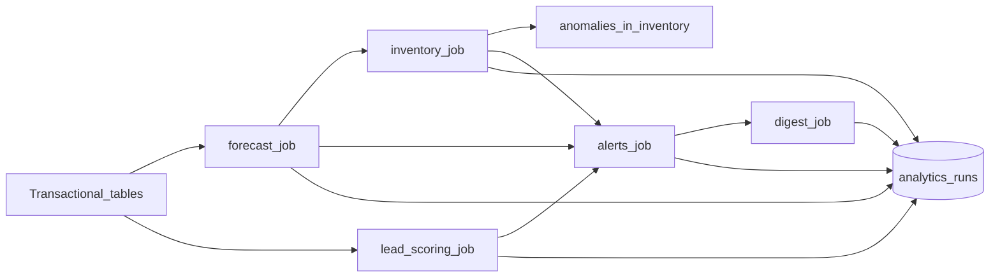
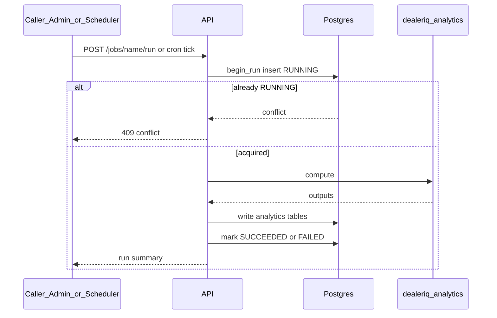

# Analytics pipeline

**Audience:** data-science-minded engineers and paper reviewers.  
**Last updated:** 2026-07-17  
**Refs:** SRS §6, Principle V, ADRs 004/005/017/018/021–025, `packages/analytics`  
**Diagrams:** [catalog D13–D14](../diagrams/README.md)

## D14 Forecast to digest pipeline

**Purpose:** How scheduled/on-demand jobs chain from transactional data to alerts and email.

Algorithms live in `packages/analytics` (`dealeriq_analytics`). Orchestration, persistence, and
RBAC live in `apps/api` (`domain/jobs/*`).

## Job contracts

Every run:

1. Inserts an `analytics_runs` row (`RUNNING`) with params, seed, code version, data window.
2. Writes outputs only to analytics tables (never mutates transactional ledgers).
3. Marks `SUCCEEDED` or `FAILED` with metrics JSON.
4. Is idempotent per (job, data snapshot) and concurrency-guarded.

On-demand: `POST /api/v1/jobs/{name}/run` (`jobs:trigger`). Cron: APScheduler when
`ENABLE_SCHEDULER=true` (ADR-004 — not Celery).

### D13 Analytics job run and concurrency guard

**Purpose:** Lifecycle of one job execution and rejection of a second concurrent run.

## Forecast job

- Builds intermittent demand series from fulfilled orders.
- SBC classification; method tournament including Seasonal Naive as **mandatory champion floor**
  (DS-FC-006): no champion without beating Seasonal Naive on MASE.
- Persists `series_profiles`, `forecasts`, `forecast_metrics`.
- Prediction intervals: conformal where methods lack native PI (ADR-025).

## Inventory intelligence job

- Consumes latest successful forecasts where needed.
- ABC-XYZ, reorder points, survival / aging risk, series + transaction anomalies
  (`dealeriq_analytics.anomalies_detector`, ADR-017).
- Persists `inventory_intel`, `unit_risk`, `anomalies`.

## Lead scoring job

- RFM profiles + logistic / coefficient-explained scores (ADR-022, ADR-023).
- PSI drift evaluation can open alerts via the alert engine.
- Persists `customer_rfm_profiles`, `lead_scores`.

## Alerts + digest

- `domain/alerts/alert_rules.py` evaluates built-in rules (stock reorder, aging, anomaly,
  forecast stockout, discount approval, lead idle, score drift, …).
- Opens/dedups `alerts` + fan-out `notifications` by subscribed roles.
- Digest job emails unread/critical summaries (MailHog locally).

Alert status machine: [domain-lifecycles D12](domain-lifecycles.md#d12-alert-lifecycle).

## Scientific gates

QA-003 suite is CI-blocking: champion vs Seasonal Naive coverage, anomaly recovery/FPR,
lead-scoring coefficient sign recovery. Synthetic ground truth under `infra/seed/ground_truth/`.

Benchmark paper: `make benchmark-paper` → `docs/paper/`.

## Related

- [how-to/trigger-jobs.md](../how-to/trigger-jobs.md)
- [runbooks/jobs-and-alerts.md](../runbooks/jobs-and-alerts.md)
- [Diagram catalog](../diagrams/README.md)
