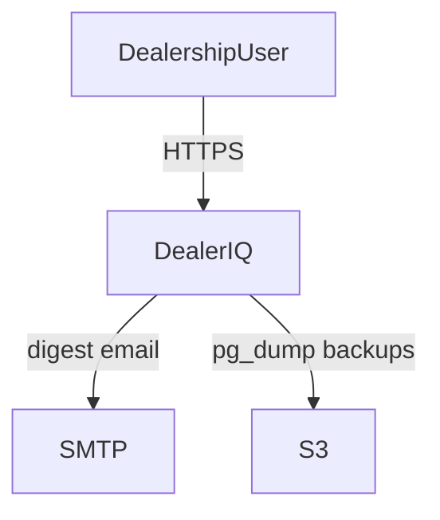
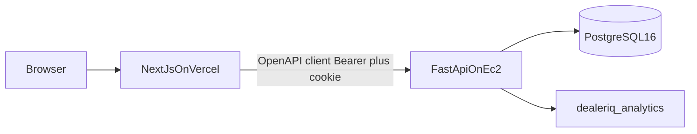
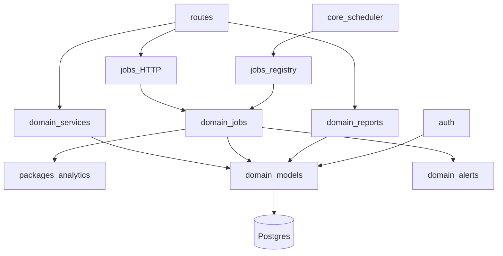
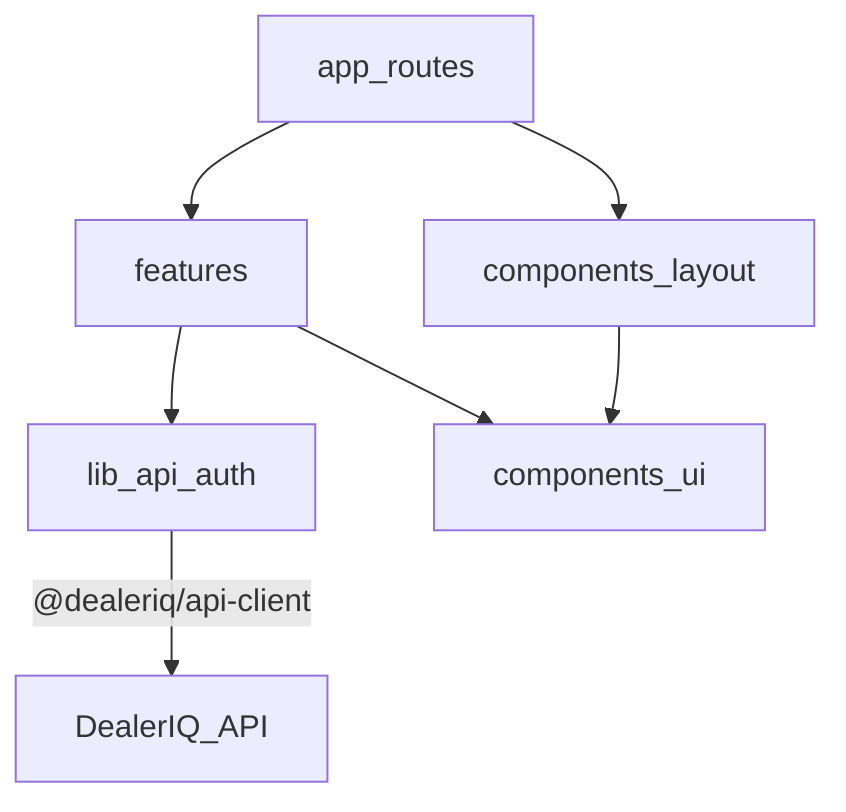
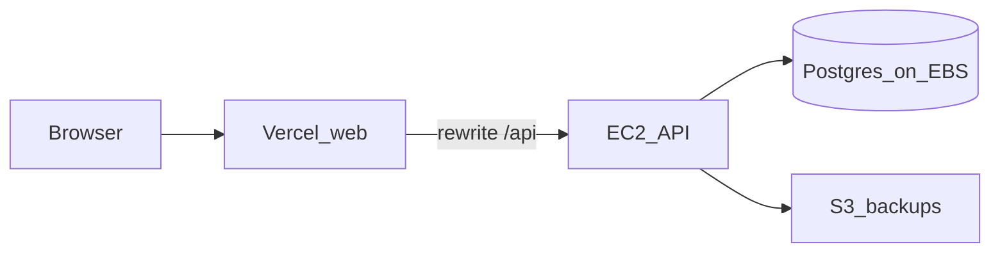

# Architecture

**Audience:** engineers and reviewers.  
**Last updated:** 2026-07-17  
**Refs:** SRS §3, ADR-001..028, constitution Principles I–VI  
**Diagrams:** [catalog D01–D04, D05 overview](../diagrams/README.md)

DealerIQ is a dealership intelligence platform: transactional sales/inventory operations plus
scheduled analytics (forecasting, inventory intelligence, anomalies, lead scoring) and
rule-based alerting.

## D01 System context

**Purpose:** Who interacts with DealerIQ and which external systems it uses.

Roles: Admin, Manager, Sales, Analyst. SMTP is MailHog locally; a real provider in production.
S3 is used only for off-box Postgres backups (ADR-026).

## D02 Containers

**Purpose:** Runtime containers and how they talk.

| Container | Tech | Notes |
|-----------|------|-------|
| Web | Next.js 15, App Router, TanStack Query | No security boundary; uses generated client |
| API | FastAPI, APScheduler, Alembic | Sole RBAC/auth boundary |
| Analytics lib | numpy/pandas/statsforecast/sklearn | Imported by API jobs; no direct DB |
| Postgres | 16 | Single store; transactional + analytics tables |
| MailHog / SMTP | local capture / real SMTP | Digests |
| S3 | backups only | ADR-026 |

## D03 API component layers

**Purpose:** Internal layering after ADR-027.

- **`auth/`** — JWT access tokens, rotating refresh cookies, `require_permission`, Argon2id
- **`domain/models`** — SQLAlchemy ORM
- **`domain/services`** — orders, leads, customers, inventory, dashboards, audit
- **`domain/jobs`** — forecast, inventory intel, lead scoring, alerts, digest
- **`domain/alerts`** — rule evaluation
- **`domain/reports`** — monthly report / sales summary / achieved accuracy
- **`routes` + `schemas`** — HTTP + Pydantic DTOs
- **No repository layer** — Session used in services/jobs directly

## D04 Web layers

**Purpose:** Frontend structure after ADR-027 feature extraction.

- `app/` — thin route shells
- `features/` — screen UI + data fetching
- `components/ui` + `components/layout` — primitives and shell/providers
- `lib/` — API client wrapper, auth context, token store

Auth sequences and RBAC visuals live in [security-model.md](security-model.md) (D07–D09).

## Production overview

Detail: [D05 in production-deploy](../runbooks/production-deploy.md#d05-production-deployment),
[durability](../runbooks/durability.md).

Local topology: [D06 in local-dev](../runbooks/local-dev.md#d06-local-development-topology).

## Related

- [Security model](security-model.md)
- [Domain lifecycles](domain-lifecycles.md)
- [Analytics pipeline](analytics-pipeline.md)
- [Data model](data-model.md)
- [Diagram catalog](../diagrams/README.md)
