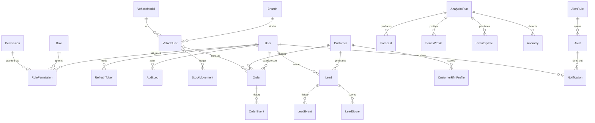

# Data model

**Audience:** backend engineers.  
**Last updated:** 2026-07-17  
**Refs:** SRS §7, DAT-001..003, Principle IV, `domain/models/`  
**Diagrams:** [catalog D15](../diagrams/README.md)

## Boundaries

| Plane | Mutated by | Examples |
|-------|------------|----------|
| Transactional | Domain services / auth | users, roles, orders, units, stock_movements, leads, customers |
| Analytics | Analytics jobs only | analytics_runs, forecasts, inventory_intel, anomalies, lead_scores |
| Audit | Explicit audit helper | audit_log (append-only) |

Transactional code must not write analytics tables; analytics jobs must not rewrite
transactional current-state columns except via documented side effects (e.g. opening alerts).

## Append-only ledgers

- **`stock_movements`** — inventory level derived from ledger, not overwritten in place.
- **`audit_log`** — security/business event trail; insert only.
- Order/lead **event** tables record state transitions.

## D15 Expanded data model

**Purpose:** Entity relationships across RBAC, CRM, inventory, analytics, and alerts.



| Area | Models |
|------|--------|
| RBAC | `User`, `Role`, `Permission`, `RolePermission`, `RefreshToken` |
| Catalog / stock | `Branch`, `VehicleModel`, `VehicleUnit`, `StockMovement` |
| CRM | `Customer`, `Lead`, `LeadEvent` |
| Sales | `Order`, `OrderEvent` |
| Analytics | `AnalyticsRun`, forecasts/metrics/profiles, inventory intel, anomalies, RFM, lead scores |
| Alerts | `AlertRule`, `Alert`, `Notification` |
| Audit | `AuditLog` |

Exact columns: SQLAlchemy under `apps/api/src/dealeriq_api/domain/models/` and Alembic under
`apps/api/alembic/versions/`. Schema changes **only** via reviewed migrations (ADR-008/011).

Domain state machines: [domain-lifecycles.md](domain-lifecycles.md).

## Migrations

```bash
cd apps/api && uv run --project .. alembic upgrade head
cd apps/api && uv run --project .. alembic revision --autogenerate -m "…"
# review before commit
```

## Related

- [Architecture](architecture.md)
- [Diagram catalog](../diagrams/README.md)
