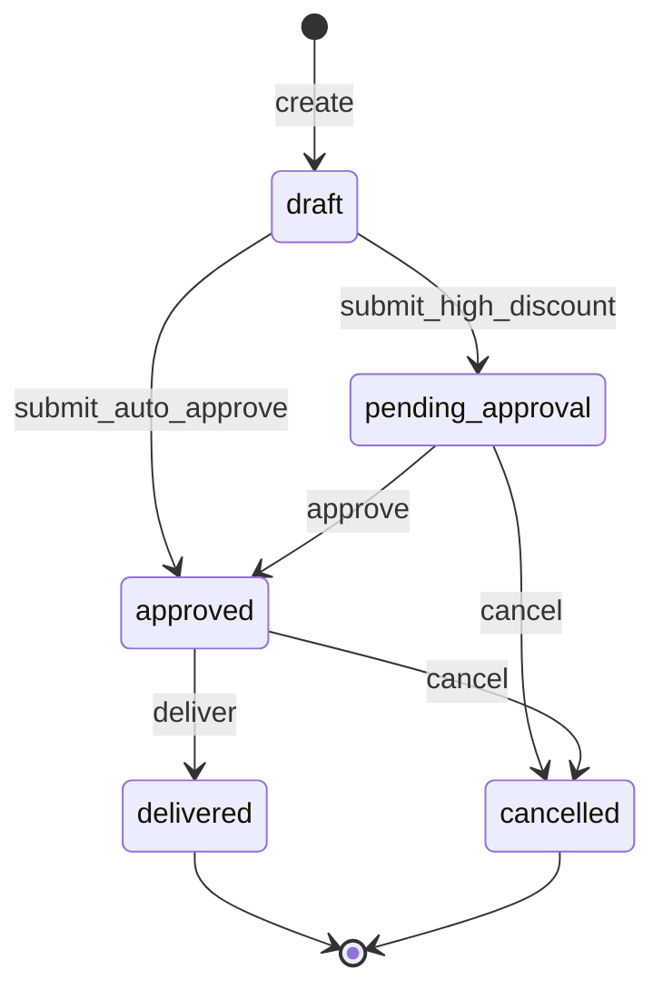
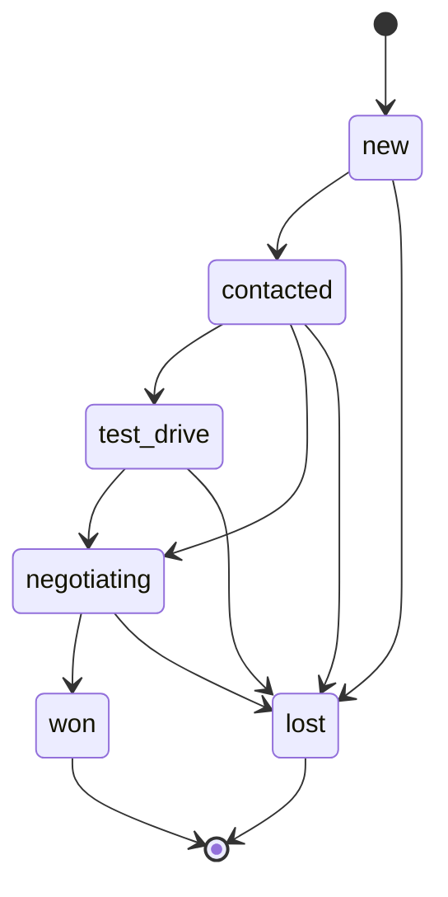
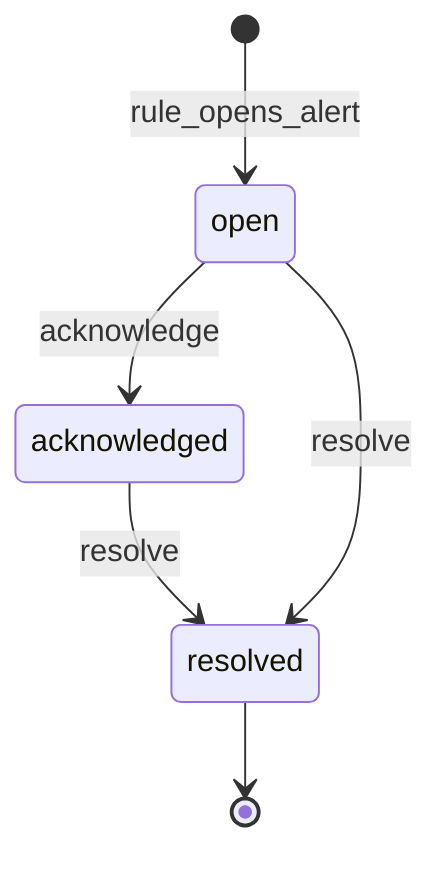

# Domain lifecycles

**Audience:** engineers and product reviewers.  
**Last updated:** 2026-07-17  
**Refs:** FR-031, FR-040..045, FR-062; `domain/services/order_service.py`,
`lead_state_machine.py`, `domain/models/alerts.py`  
**Diagrams:** [catalog D10–D12](../diagrams/README.md)

State machines for the three primary operational entities.

## D10 Order lifecycle

**Purpose:** Legal order status transitions (create → submit → approve → deliver / cancel).

- Submit from `draft`: if discount exceeds `ORDER_APPROVAL_DISCOUNT_THRESHOLD`, status becomes
  `pending_approval`; otherwise `approved` (and unit reserved).
- Cancel is allowed from `pending_approval` or `approved` (releases reservation when approved).
- `delivered` and `cancelled` are terminal.

## D11 Lead funnel

**Purpose:** Allowed lead status transitions from `ALLOWED_TRANSITIONS` (FR-031).

- `lost` is reachable from any non-terminal state.
- `won` and `lost` are terminal; no skip from early stages directly to `won`.

## D12 Alert lifecycle

**Purpose:** In-app alert status from open through acknowledge to resolve (FR-062).

At most one non-`RESOLVED` alert per `(rule_key, dedup_key)` (partial unique index).

## Related

- [Data model](data-model.md)
- [Analytics pipeline](analytics-pipeline.md) (rules that open alerts)
- [Permissions](../reference/permissions.md)
- [Diagram catalog](../diagrams/README.md)
