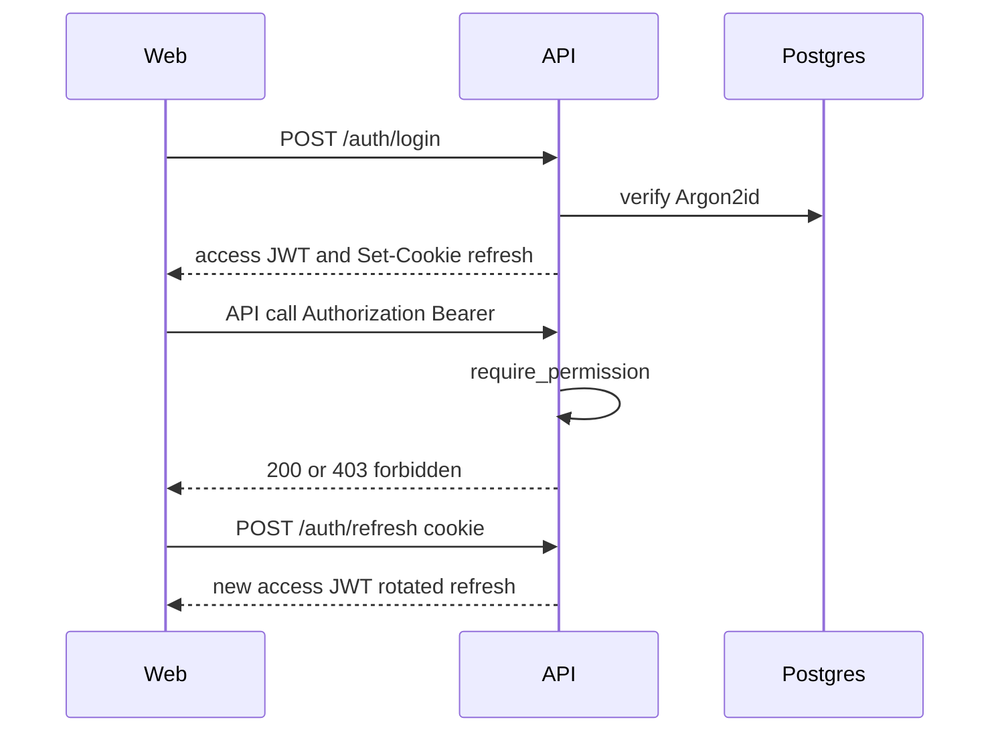
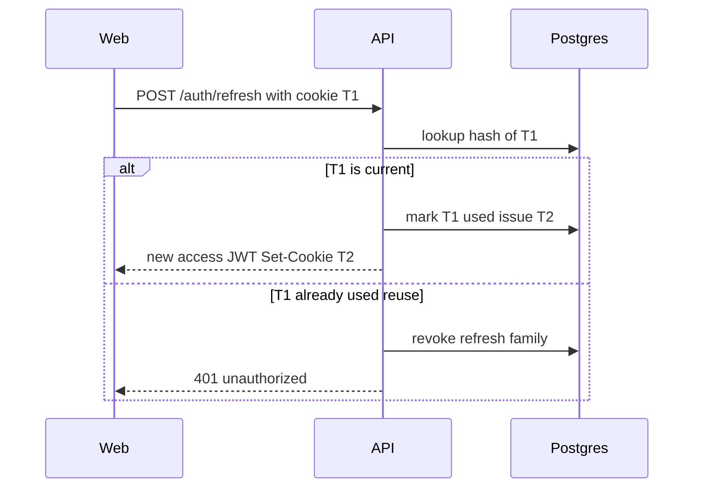
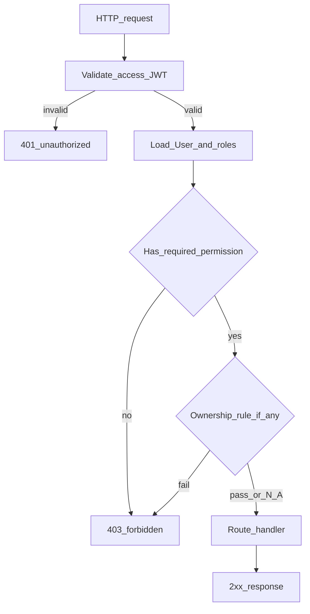
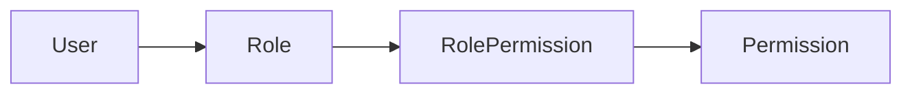

# Security model

**Audience:** engineers, operators, auditors.  
**Last updated:** 2026-07-17  
**Refs:** Constitution III, FR-001..012, ADR-006/009/010/019/020, SEC/NFR in SRS  
**Diagrams:** [catalog D07-D09](../diagrams/README.md)

## Principles

1. **API is the only security boundary.** UI hiding is cosmetic.
2. **Deny by default.** Every protected route declares
   `Depends(require_permission("resource:action"))`.
3. **No self-registration** (FR-004). Bootstrap Admin via migration + env; further users via Admin UI.

## Authentication

| Mechanism | Detail |
|-----------|--------|
| Access token | JWT, ≤15 min TTL, `Authorization: Bearer` (ADR-010) |
| Refresh token | Opaque, httpOnly, SameSite=Strict cookie; rotation + reuse detection (ADR-019) |
| Passwords | Argon2id ≥ SRS floor (ADR-009) |
| Lockout | Configurable attempts / window / duration |
| Forced password change | `must_change_password` on bootstrap / reset accounts |

### D07 Login and authenticated request

**Purpose:** Happy-path login, API call with Bearer token, and silent refresh.

### D08 Refresh-token rotation and reuse detection

**Purpose:** ADR-019 - each refresh issues a new opaque token; presenting a already-rotated
token is treated as theft (family revoke).

## Authorization

- Role → permissions many-to-many (`roles`, `permissions`, `role_permissions`).
- Machine-readable `403` with `error.code = "forbidden"`.
- Ownership helpers (`assert_owner_or_permission`) on write paths for Sales-owned resources
  (FR-012). List/read scoping is permission-based; see backlog/reviews for known gaps.

Full matrix: [reference/permissions.md](../reference/permissions.md).

### D09 RBAC deny-by-default

**Purpose:** How a request is authorized (or rejected) at the API boundary.

## Transport & headers

- CORS allow-list from `CORS_ORIGINS`.
- Security headers middleware (`core/security_headers.py`).
- Rate limiting via slowapi (ADR-020) on auth-sensitive routes.

## Audit

Append-only `audit_log` for security-relevant mutations (user manage, order transitions, alert
ack/resolve, etc.). Viewable with `audit_log:view`.

## Secrets handling

| Environment | Where secrets live |
|-------------|-------------------|
| Local | `.env` (gitignored); placeholders in `.env.example` |
| Laptop deploy stash | `.deploy-secrets/` (gitignored; not the production path) |
| Production | `/etc/dealeriq/prod.env` on EC2; Vercel env for web; IAM role for S3 |

Never commit production secrets. Gitleaks runs in pre-commit and CI. See [`SECURITY.md`](../../SECURITY.md).

## Threat notes (v1.0 scope)

- Synthetic / portfolio data - not a multi-tenant SaaS isolation model (NFR-021 future).
- Frontend never trusted for authorization decisions.
- OpenAPI/docs disabled outside `APP_ENV=development`.
- Dependency findings gated by `scripts/ci/check_dependency_audit.py` +
  `security/dependency-waivers.json`.

## Related

- [Architecture](architecture.md)
- [Permissions matrix](../reference/permissions.md)
- [Diagram catalog](../diagrams/README.md)
