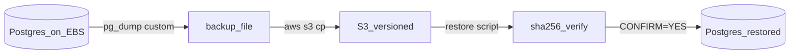

# Data durability (ADR-026) — survive EC2 termination

Production Postgres lives on a **dedicated EBS volume**
(`DeleteOnTermination=false`) bind-mounted at
`${DEALERIQ_DATA_ROOT:-/var/lib/dealeriq}/pgdata`, and is mirrored nightly to
**S3**. Local `make dev` / `infra/docker-compose.yml` stay on named volumes +
MailHog — this runbook is host-only.

The API stores no uploads on disk; backups are **DB-only**.

See also: [`production-deploy.md`](production-deploy.md),
[`docs/adr/026-production-data-durability.md`](../adr/026-production-data-durability.md).

## D18 Backup and restore

**Purpose:** Nightly off-box backup and destructive restore path (ADR-026).



Use `DRY_RUN=1` before any restore. Catalog: [diagrams D18](../diagrams/README.md).

## 1. Provision and mount the data EBS volume

Replace `<az>`, `<instance-id>`, and region to match the production EC2
(`eu-central-1`).

```bash
# Create (example: 20 GiB gp3 in the instance AZ — enough for showcase scale)
VOL_ID=$(aws ec2 create-volume \
  --availability-zone <az> \
  --size 20 \
  --volume-type gp3 \
  --tag-specifications 'ResourceType=volume,Tags=[{Key=Name,Value=dealeriq-data}]' \
  --query VolumeId --output text)

aws ec2 wait volume-available --volume-ids "$VOL_ID"
aws ec2 attach-volume --volume-id "$VOL_ID" --instance-id <instance-id> --device /dev/xvdf

# On the instance (device name may appear as /dev/nvme1n1 on Nitro):
sudo mkfs.ext4 /dev/xvdf   # only on first attach — never format a volume that already has data
sudo mkdir -p /var/lib/dealeriq
echo '/dev/xvdf /var/lib/dealeriq ext4 defaults,nofail 0 2' | sudo tee -a /etc/fstab
sudo mount -a
sudo mkdir -p /var/lib/dealeriq/pgdata
# Postgres image runs as uid 999 (debian); empty pgdata is fine — the entrypoint
# chowns on first boot. Do not seed random files into pgdata.
```

**Critical:** when attaching (or in the EC2 console → Volume → Attachment
settings), set **Delete on termination = false**. Confirm:

```bash
aws ec2 describe-volumes --volume-ids "$VOL_ID" \
  --query 'Volumes[0].Attachments[0].DeleteOnTermination'
# → false
```

If the instance is terminated, the volume remains. Attach it to a replacement
instance in the **same AZ**, mount at `/var/lib/dealeriq`, clone the repo, and
bring Compose up — data is already there.

### Migrating an existing named-volume deploy

If Postgres was already running on the Docker named volume `pgdata`:

1. `docker compose -f infra/docker-compose.prod.yml --env-file /etc/dealeriq/prod.env stop`
2. Copy data out of the named volume into the new mount (example):

```bash
sudo docker run --rm \
  -v dealeriq-prod_pgdata:/from \
  -v /var/lib/dealeriq/pgdata:/to \
  alpine sh -c 'cd /from && cp -a . /to/'
```

3. Pull this ADR-026 compose change, then `up -d` so the bind-mount is used.
4. Confirm `docker compose ... exec postgres psql -U dealeriq -c '\dt'` still lists tables.
5. Only then remove the old named volume if desired.

## 2. S3 bucket + IAM instance role

```bash
BUCKET=dealeriq-prod-backups   # globally unique name
REGION=eu-central-1
aws s3api create-bucket --bucket "$BUCKET" --region "$REGION" \
  --create-bucket-configuration LocationConstraint="$REGION"
aws s3api put-bucket-versioning --bucket "$BUCKET" \
  --versioning-configuration Status=Enabled
aws s3api put-bucket-encryption --bucket "$BUCKET" \
  --server-side-encryption-configuration \
  '{"Rules":[{"ApplyServerSideEncryptionByDefault":{"SSEAlgorithm":"AES256"}}]}'
# Optional lifecycle: expire noncurrent dump versions after 90 days.
```

Attach an instance profile whose role allows only your prefix (example policy):

```json
{
  "Version": "2012-10-17",
  "Statement": [
    {
      "Effect": "Allow",
      "Action": ["s3:ListBucket"],
      "Resource": ["arn:aws:s3:::dealeriq-prod-backups"],
      "Condition": {
        "StringLike": { "s3:prefix": ["prod/*"] }
      }
    },
    {
      "Effect": "Allow",
      "Action": ["s3:GetObject", "s3:PutObject", "s3:DeleteObject"],
      "Resource": ["arn:aws:s3:::dealeriq-prod-backups/prod/*"]
    }
  ]
}
```

Install the AWS CLI on the host (`aws sts get-caller-identity` must succeed via
the instance role — no access keys in `prod.env` or git).

Document on the host:

- `DEALERIQ_DATA_ROOT=/var/lib/dealeriq` in `/etc/dealeriq/prod.env` (optional;
  compose default matches).
- `BACKUP_S3_URI=s3://dealeriq-prod-backups/prod` in `/etc/dealeriq/backup.env`.

## 3. Enable the daily backup timer

Assume the repo is cloned at `/opt/dealeriq/src` (matches
[`production-deploy.md`](production-deploy.md)):

```bash
sudo mkdir -p /etc/dealeriq
sudo cp deploy/systemd/backup.env.example /etc/dealeriq/backup.env
sudo edit /etc/dealeriq/backup.env   # set BACKUP_S3_URI=s3://dealeriq-prod-backups/prod
sudo chmod 0640 /etc/dealeriq/backup.env

sudo cp deploy/systemd/dealeriq-backup.service \
       deploy/systemd/dealeriq-backup.timer /etc/systemd/system/
# If the clone is not /opt/dealeriq/src, edit WorkingDirectory + ExecStart.
sudo systemctl daemon-reload
sudo systemctl enable --now dealeriq-backup.timer

# Manual run / verify:
sudo systemctl start dealeriq-backup.service
sudo systemctl status dealeriq-backup.service
aws s3 ls s3://dealeriq-prod-backups/prod/postgres/
aws s3 cp s3://dealeriq-prod-backups/prod/postgres/LATEST -
```

Dry-run without uploading (from the repo root on the host):

```bash
BACKUP_S3_URI=s3://dealeriq-prod-backups/prod DRY_RUN=1 ./scripts/ops/backup-to-s3.sh
```

## 4. Disaster recovery

**A — Instance gone, EBS volume intact (preferred):**

1. Launch a new EC2 in the **same AZ**, attach the volume, mount `/var/lib/dealeriq`.
2. Clone the repo to `/opt/dealeriq/src`, copy `/etc/dealeriq/prod.env`, install Docker.
3. `docker compose -f infra/docker-compose.prod.yml --env-file /etc/dealeriq/prod.env up -d --build`
4. Smoke-test `/api/v1/health` and login. No S3 restore needed.
5. Re-associate the Elastic IP if needed (so Vercel `API_REWRITE_ORIGIN` stays valid).

**B — Volume also lost (or wrong AZ):**

```bash
cd /opt/dealeriq/src
# Preview
BACKUP_S3_URI=s3://dealeriq-prod-backups/prod DRY_RUN=1 ./scripts/ops/restore-from-s3.sh

# Apply (destructive to the local DB)
BACKUP_S3_URI=s3://dealeriq-prod-backups/prod CONFIRM=YES ./scripts/ops/restore-from-s3.sh
# Or pin a day: BACKUP_DAY=2026-07-15 CONFIRM=YES ./scripts/ops/restore-from-s3.sh
```

Restore stops `api`, recreates the database from the dump, and restarts `api`
(entrypoint runs `alembic upgrade head`).

## 5. What this does *not* cover

- Multi-region active-active replication.
- Point-in-time recovery finer than the last successful nightly dump (take an
  extra manual backup before high-risk ops:
  `sudo systemctl start dealeriq-backup.service`).
- Vercel frontend / auth cookie config — unchanged by this runbook.
