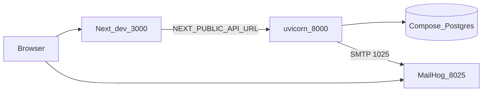

# Runbook: Local Development

## Prerequisites

git, Python 3.12+, [uv](https://docs.astral.sh/uv/), Node 20+, npm, Docker + Docker Compose.
Verify with:

```bash
git --version && python3 --version && uv --version && node --version && npm --version \
  && docker --version && docker compose version
```

## D06 Local development topology

**Purpose:** What `make bootstrap` / `make seed` / `make dev` start on a laptop.



Catalog: [diagrams D06](../diagrams/README.md).

## First-time setup

```bash
cp .env.example .env       # done automatically by `make bootstrap` if missing
make bootstrap              # installs Python (uv workspace) + Node (npm workspaces) deps,
                             # fetches a pinned gitleaks binary into .tools/bin/, installs
                             # the pre-commit git hook
make seed                    # starts postgres + mailhog (docker compose), runs
                             # `alembic upgrade head`
make dev                     # starts the API (uvicorn --reload, :8000) and web
                             # (next dev, :3000) concurrently; Ctrl+C stops both
```

Then visit `http://localhost:3000` (web app) and `http://localhost:8000/api/v1/docs`
(interactive OpenAPI docs). MailHog's web UI (captured emails, from Phase 6 onward) is at
`http://localhost:8025`.

## Bringing infra down

```bash
make down     # stops postgres + mailhog containers (data persists in the pgdata volume)
```

To fully reset the database, stop the containers and remove the `pgdata` volume:

```bash
make down
docker volume rm dealeriq_pgdata
make seed
```

## Running checks locally (same as CI)

```bash
make lint     # ruff, ruff format --check, mypy --strict, eslint, tsc --noEmit
make test     # pytest (apps/api, packages/analytics) + vitest (apps/web)
make ci       # lint + test + next build + regenerate/compile the API client
```

## Signing in (dev seed accounts)

**Dev only — never use these passwords in production.** Accounts come from the migration
bootstrap Admin plus `make seed` (`infra/seed/generate.py`). Defaults live in
`Settings` / `SEED_USER_PASSWORD` and are intentionally predictable for local work.

| Role | Email | Password | Notes |
|------|-------|----------|-------|
| Admin | `admin@dealeriq.dev` | `ChangeMe123!` | Full permissions; first login forces password change |
| Manager | `manager1@dealeriq.dev`, `manager2@dealeriq.dev` | `SeedUser123!` | Manager dashboard, approvals, margin visibility |
| Sales | `sales1@dealeriq.dev` … `sales8@dealeriq.dev` | `SeedUser123!` | Own leads/orders (intended); Sales dashboard |
| Analyst | `analyst1@dealeriq.dev` | `SeedUser123!` | Read analytics/intel; no order/lead writes |

App: http://localhost:3000 · API docs: http://localhost:8000/api/v1/docs · MailHog: http://localhost:8025

Self-registration is disabled (FR-004). Re-running `make seed` against a fresh volume regenerates
the same emails/passwords (deterministic seed).

## Logs

- API logs are structured JSON on stdout (one line per request: request id, method, path,
  status, latency — NFR-006). When running via `make dev` they print directly to your
  terminal.
- Postgres/MailHog container logs: `docker compose -f infra/docker-compose.yml logs -f
  [postgres|mailhog]`.

## Regenerating the API client

The generated TypeScript client (`packages/api-client/src/schema.d.ts`) is committed to the
repo. Regenerate it whenever the API's routes/schemas change, with the API running:

```bash
make dev &      # or otherwise ensure the API is reachable at NEXT_PUBLIC_API_URL
npm run generate:client
git add packages/api-client/src/schema.d.ts
```

CI fails the build if the committed schema drifts from what the live API actually serves
(QA-005) — always regenerate and commit after changing any route/response model.

## Troubleshooting

- **`make dev` fails immediately with a Docker error**: Docker isn't running — start Docker
  Desktop/the Docker daemon and retry.
- **Alembic can't connect**: confirm `make seed` has been run at least once and
  `docker compose -f infra/docker-compose.yml ps` shows `postgres` as healthy.
- **gitleaks pre-commit hook fails on a false positive**: add a narrowly-scoped allowlist entry
  to `.gitleaks.toml` — never disable the hook.
