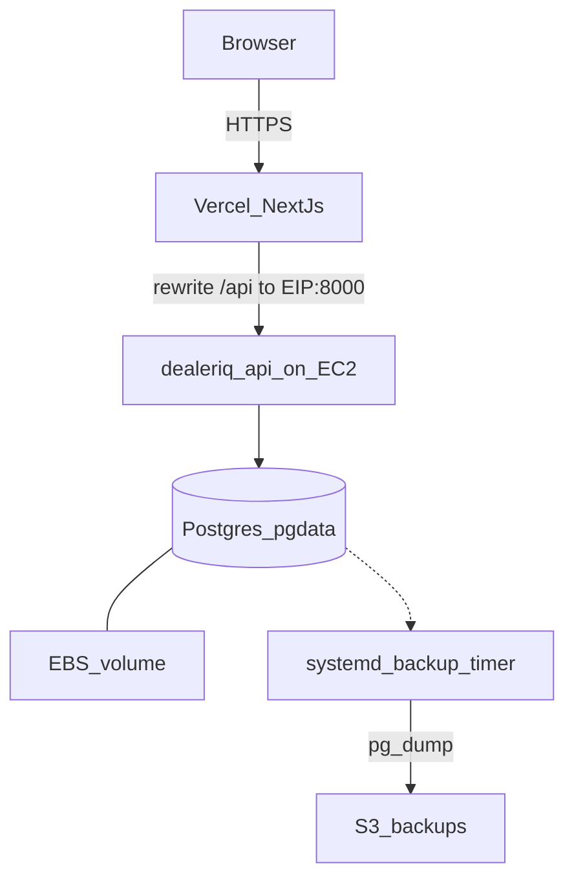

# Production deploy (AWS micro VM + Vercel Git)

DealerIQ production layout:

| Layer | Where |
|---|---|
| Web | Vercel project `dealeriq`, Root Directory `apps/web`, GitHub `ahmedmshazly/dealeriq` (private) |
| API + Postgres | One EC2 `t3.micro` in `eu-central-1` running `infra/docker-compose.prod.yml` |
| Durable DB disk | Dedicated EBS volume bind-mounted at `/var/lib/dealeriq/pgdata` (`DeleteOnTermination=false`) — [durability.md](durability.md) / ADR-026 |
| Off-box backups | Nightly `pg_dump` → S3 via `scripts/ops/backup-to-s3.sh` + systemd timer |
| Auth cookies | Browser talks same-origin to Vercel; `API_REWRITE_ORIGIN` proxies `/api/*` to the EC2 API |

Firestore / Firebase is **not** used (stack is Postgres + SQLAlchemy + Alembic).

## D05 Production deployment

**Purpose:** How browser traffic, Vercel, EC2 API, EBS Postgres, and S3 backups relate.



Catalog: [diagrams D05](../diagrams/README.md).

## Current production endpoints

- Web: `https://dealeriq-nine.vercel.app`
- API (direct, rewrite target): `http://<EIP>:8000` — health: `/api/v1/health`
- GitHub: `https://github.com/ahmedmshazly/dealeriq` (private)

Vercel env (Production / Preview / Development):

- `API_REWRITE_ORIGIN` = `http://<EIP>:8000` (encrypted)
- `NEXT_PUBLIC_API_URL` = empty (same-origin relative `/api/...`)

EC2 host secrets live only on the instance at `/etc/dealeriq/prod.env` (mode `600`). Template: [`infra/prod.env.example`](../infra/prod.env.example).

## Recreate / bootstrap the micro VM

Region: `eu-central-1`. Prefer the existing Elastic IP so Vercel rewrites stay valid.

1. Security group: SSH `22` from your IP; TCP `8000` from `0.0.0.0/0` (Vercel → API only; browsers use Vercel).
2. Launch Amazon Linux 2023 `t3.micro`, 20 GB gp3 root, key pair, associate EIP. Attach a **separate data EBS** with `DeleteOnTermination=false` (see [durability.md](durability.md)).
3. User-data / first boot: install Docker + Compose plugin + AWS CLI, create a **2 GB swapfile**, `mkdir /opt/dealeriq /etc/dealeriq`, mount data volume at `/var/lib/dealeriq`.
4. Clone the private repo into `/opt/dealeriq/src` (deploy key or short-lived `gh` token).
5. Copy `infra/prod.env.example` → `/etc/dealeriq/prod.env`, set strong `POSTGRES_PASSWORD`, `JWT_SECRET_KEY`, `BOOTSTRAP_ADMIN_PASSWORD`, and `CORS_ORIGINS=https://dealeriq-nine.vercel.app`. Optionally set `DEALERIQ_DATA_ROOT=/var/lib/dealeriq`.
6. Start:

```bash
cd /opt/dealeriq/src
sudo mkdir -p /var/lib/dealeriq/pgdata
sudo docker compose -f infra/docker-compose.prod.yml --env-file /etc/dealeriq/prod.env up -d --build
curl -fsS http://127.0.0.1:8000/api/v1/health
```

7. Enable nightly S3 backups ([durability.md](durability.md) §3): instance IAM role + `/etc/dealeriq/backup.env` + `dealeriq-backup.timer`.

The API entrypoint runs `alembic upgrade head` before uvicorn. Optional seed (heavy): run `uv`/seed inside a one-off container only if you need demo data.

## Vercel (Git auto-deploy)

Already linked: pushes to `main` on `ahmedmshazly/dealeriq` trigger Production deploys.

```bash
# Local ops
vercel link --project dealeriq --scope ahmdmshazly
vercel env ls
vercel deploy --prod   # manual; prefer git push for normal releases
```

If the EIP changes, update `API_REWRITE_ORIGIN` in the Vercel project and redeploy.

Project settings that matter:

- Root Directory: `apps/web`
- Install: `cd ../.. && npm install`
- Build: `cd ../.. && npm run build:web`
- Framework: Next.js
- Rewrites: via `apps/web/next.config.ts` when `API_REWRITE_ORIGIN` is set

## Rotate secrets

1. Generate new values (`python -c "import secrets; print(secrets.token_urlsafe(48))"`).
2. Edit `/etc/dealeriq/prod.env` on EC2; `docker compose ... up -d --force-recreate api` (and postgres only if the DB password changed — that requires volume care).
3. After first Admin login, change the bootstrap password in-app (`must_change_password`).

## Cost guardrails

- Keep **one** `t3.micro` only; stop the instance when idle:

```bash
aws ec2 stop-instances --region eu-central-1 --instance-ids <INSTANCE_ID>
# later:
aws ec2 start-instances --region eu-central-1 --instance-ids <INSTANCE_ID>
```

EIP stays attached while stopped (small hourly EIP charge if unattached — keep it associated).
- No RDS, ALB, NAT, Fargate, or Firestore. Postgres stays on Compose + EBS + S3 dumps (ADR-026), not a managed DB.
- If the API OOMs under analytics load, bump once to `t3.small` rather than adding services.

## Durability / DR

Full procedure (EBS mount, S3 bucket, IAM, path A reattach / path B restore): [`durability.md`](durability.md).

## Smoke checks

```bash
curl -fsS https://dealeriq-nine.vercel.app/api/v1/health
curl -fsS -X POST https://dealeriq-nine.vercel.app/api/v1/auth/login \
  -H 'Content-Type: application/json' \
  -d '{"email":"admin@dealeriq.dev","password":"<BOOTSTRAP_ADMIN_PASSWORD>"}' \
  -c /tmp/dj.txt
# Expect access_token + Set-Cookie dealeriq_refresh on dealeriq-nine.vercel.app path /api/v1/auth
```

Open `https://dealeriq-nine.vercel.app/login`, sign in, complete forced password change, reach `/dashboard`.
