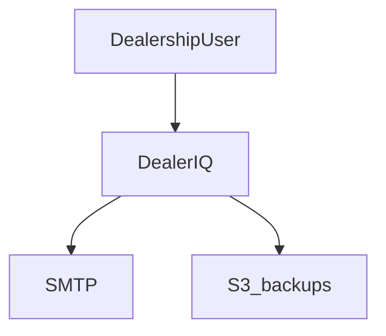
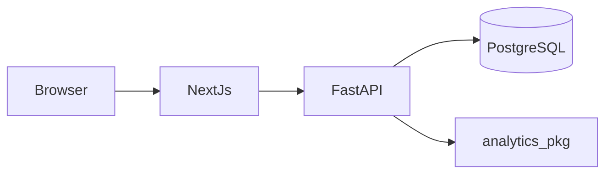

# Software Requirements Specification (SRS)

## DealerIQ — Dealership Intelligence Platform

| Field | Value |
|---|---|
| Document ID | DIQ-SRS-001 |
| Version | 1.0.0 |
| Status | Accepted — v1.0.0 shipped; layout refined per ADR-027 |
| Author | Ahmed Elshazly |
| Date | 2026-07-10 |
| Standard alignment | ISO/IEC/IEEE 29148:2018 (adapted), IEEE 830 structure |

---

## Table of Contents

1. [Introduction](#1-introduction)
2. [Overall Description](#2-overall-description)
3. [System Architecture & Repository Strategy](#3-system-architecture--repository-strategy)
4. [User Roles & Personas](#4-user-roles--personas)
5. [Functional Requirements](#5-functional-requirements)
6. [Data Science & Analytics Specification](#6-data-science--analytics-specification)
7. [Data Model](#7-data-model)
8. [API Specification (Outline)](#8-api-specification-outline)
9. [Non-Functional Requirements](#9-non-functional-requirements)
10. [Synthetic Data Generation Specification](#10-synthetic-data-generation-specification)
11. [Testing & Quality Strategy](#11-testing--quality-strategy)
12. [DevOps, Environments & Deployment Path](#12-devops-environments--deployment-path)
13. [Delivery Plan / Phases (Milestones)](#13-delivery-plan--phases-milestones)
14. [Acceptance Criteria Summary](#14-acceptance-criteria-summary)
15. [Research & Paper Track](#15-research--paper-track)
16. [Glossary](#16-glossary)
17. [References](#17-references)

---

## 1. Introduction

### 1.1 Purpose

This SRS defines the requirements for **DealerIQ**, a dealership intelligence platform that layers automated data science — demand forecasting, inventory optimization, anomaly detection, customer analytics, and an alerting engine — on top of a transactional sales-and-inventory system for automotive dealerships.

The document serves three purposes:

1. **Build input** — the authoritative specification for the build. Each numbered requirement (FR-xxx / NFR-xxx / DS-xxx) is intended to map to feature specifications and task breakdowns.
2. **Portfolio artifact** — the specification itself demonstrates enterprise-grade requirements engineering and will be published alongside the project.
3. **Research protocol** — Section 6 and Section 15 define a reproducible forecasting benchmark suitable for writing up as a short applied paper.

### 1.2 Background & Motivation

The predecessor system (NaserSalem Motors, 2022) was a Django + PostgreSQL system of record: role-based order entry, stock tracking, and reporting, credited with a ~30% improvement in order-report accuracy. It answered *"what happened?"*

DealerIQ answers *"what will happen, what is abnormal, and what should we do?"* — automatically, on a schedule, with statistically defensible methods. The central technical thesis: **dealership vehicle sales are intermittent, low-volume time series** (frequently 0–3 units per model per week), a regime where classical smoothing/ARIMA methods are known to underperform and specialized intermittent-demand methods (Croston, SBA, TSB) and careful evaluation metrics (MASE, pinball loss) are required. DealerIQ operationalizes that literature in a working product.

### 1.3 Scope

**In scope (v1.0):**

- Full-stack web application: authentication, RBAC, dealership operations (inventory, orders, customers, leads), dashboards.
- Automated analytics pipeline: scheduled forecasting, inventory intelligence, anomaly detection, customer/lead scoring.
- Rule-based alerting engine with in-app notification center and email digests (local SMTP capture in dev).
- Seeded synthetic data generator with a documented statistical generative process.
- Reproducible forecasting benchmark harness (rolling-origin cross-validation, multiple methods, standardized metrics).
- Local-first deployment: Docker Compose, PostgreSQL, zero paid services.
- Full engineering hygiene: migrations, OpenAPI, typed API client, tests, CI, structured logging, audit trail, ADRs.

**Out of scope (v1.0, documented as future stages):**

- Production hosting on Vercel + managed Postgres (Stage 2; migration path specified in §12.4).
- Real third-party integrations (payment, DMS/CRM imports beyond CSV, SMS providers).
- Multi-tenancy / multiple dealership organizations (schema is designed not to preclude it; see NFR-021).
- Mobile native apps.
- Deep learning forecasting (N-BEATS/N-HiTS/TFT) — allowed as a Stage-3 challenger only after classical baselines are established (see DS-FC-010 rationale).

### 1.4 Definitions & Conventions

- Requirement IDs: `FR-` functional, `NFR-` non-functional, `DS-` data science, `DAT-` data, `SEC-` security-specific.
- Priority: **P0** (must-have for v1.0), **P1** (should-have), **P2** (nice-to-have / stretch).
- Keywords **SHALL/MUST**, **SHOULD**, **MAY** follow RFC 2119 semantics.
- "System" refers to the complete DealerIQ platform (API + web + analytics workers) unless qualified.

---

## 2. Overall Description

### 2.1 Product Perspective

DealerIQ is a greenfield monorepo application composed of:

- **`apps/api`** — FastAPI (Python 3.12) backend: REST API, auth, RBAC, business logic, background job scheduler (APScheduler), alerting engine.
- **`apps/web`** — Next.js 15 (TypeScript, App Router) frontend: dashboards, operational screens, notification center, admin console.
- **`packages/analytics`** — Python analytics library: forecasting, inventory intelligence, anomaly detection, customer analytics, benchmark harness. Imported by the API's job runner; also runnable standalone as a CLI for experiments.
- **`packages/api-client`** — TypeScript client generated from the API's OpenAPI schema (single source of truth for the contract).
- **`infra/`** — Docker Compose (PostgreSQL 16, MailHog for local email capture), seed scripts.
- **`docs/`** — this SRS, ADRs (Architecture Decision Records), runbooks, the paper draft.

### 2.2 Operating Environment

- Local development on Linux/macOS/Windows-WSL2 via Docker Compose. No paid services.
- PostgreSQL 16 (Docker), MailHog (Docker) for SMTP capture, Node 20+, Python 3.12.
- Future: frontend on Vercel; API + scheduler on a free-tier worker host or Vercel Functions + Vercel Cron; database on a free Postgres tier (Neon or Supabase). See §12.4.

### 2.3 Design Constraints

- **C-01** All services and dependencies MUST be free/open-source for local operation.
- **C-02** The API MUST be stateless with respect to auth (token-based), so it can later run in serverless contexts.
- **C-03** Scheduled analytics MUST be triggerable both by the internal scheduler and by an authenticated HTTP endpoint (so Vercel Cron can drive them later without code changes).
- **C-04** All analytics MUST be reproducible: fixed seeds, versioned parameters, persisted run metadata.
- **C-05** The frontend MUST consume only the generated typed client — no hand-written fetch calls to undocumented endpoints.

### 2.4 Assumptions & Dependencies

- Single dealership organization in v1.0; multiple branches supported.
- Data volume assumptions: ≤ 100k orders, ≤ 10k vehicles, ≤ 50k customers — all analytics must run comfortably on a laptop within these bounds.
- Users access via modern evergreen browsers.

---

## 3. System Architecture & Repository Strategy

### 3.1 Repository Decision (single monorepo)

**Decision: one GitHub monorepo** (`dealeriq/`). Rationale (recorded as ADR-001):

- Atomic commits across API contract + generated client + frontend.
- One workspace, one CI pipeline, one review surface for portfolio visitors.
- Vercel natively supports monorepos via Root Directory (`apps/web`).
- Two repos are justified by independent teams/release cadences — neither applies here.

### 3.1.1 Visual architecture

Mermaid diagrams for context, containers, deployment, auth, domain state machines, data model,
and CI live in [`docs/diagrams/README.md`](../diagrams/README.md) (catalog D01–D18). Narrative
architecture: [`docs/explanation/architecture.md`](../explanation/architecture.md).





### 3.2 Monorepo Layout

Top-level roots are fixed by ADR-001. Internal layout under those roots is refined by
ADR-027 (Diataxis docs portal, layered `domain/`, web `features/`).

```
dealeriq/
├── apps/
│   ├── api/                  # FastAPI service
│   │   ├── src/dealeriq_api/
│   │   │   ├── auth/         # JWT, RBAC, password hashing
│   │   │   ├── domain/       # models/, services/, alerts/, reports/, jobs/
│   │   │   ├── routes/       # REST endpoints (versioned /api/v1)
│   │   │   ├── jobs/         # thin APScheduler / HTTP job name registry
│   │   │   ├── schemas/      # Pydantic API DTOs
│   │   │   └── core/         # config, logging, db session, errors
│   │   ├── alembic/          # migrations
│   │   └── tests/
│   └── web/                  # Next.js app
│       ├── app/              # App Router routes (thin)
│       ├── features/         # feature UI and data hooks
│       ├── components/       # shared UI + layout
│       ├── lib/              # API client, auth, utilities
│       └── tests/
├── packages/
│   ├── analytics/            # Python: forecasting, anomalies, scoring, benchmark CLI
│   └── api-client/           # generated TS client (openapi-typescript)
├── infra/
│   ├── Dockerfile            # production API image
│   ├── docker-compose.yml    # local postgres + mailhog
│   ├── docker-compose.prod.yml
│   └── seed/                 # synthetic data generator
├── scripts/
│   ├── ops/                  # backup / restore
│   └── ci/                   # audit gate, latency benchmark
├── deploy/                   # systemd units for prod backups
├── docs/                     # Diataxis portal — see docs/README.md
│   ├── getting-started/ how-to/ reference/ explanation/
│   ├── srs/ adr/ runbooks/ paper/
├── specs/                    # planning archive (not product docs)
├── .github/workflows/        # CI
└── Makefile                  # one-command dev tasks
```

### 3.3 Runtime Architecture

- The **web app** talks only to the **API** over REST (JSON, versioned under `/api/v1`).
- The **API** owns the database. The analytics package receives dataframes/queries through a thin repository layer — analytics code never writes raw SQL against production tables directly; it reads via defined query functions and writes results to dedicated analytics tables (forecasts, anomalies, scores, runs).
- **APScheduler** runs inside the API process in local mode (single instance), executing analytics jobs on cron schedules; each job is also exposed as `POST /api/v1/jobs/{job_name}/run` (admin-only) per C-03.
- **Alert engine** subscribes to analytics-run completion and to transactional events (e.g., order created), evaluates rules, and writes notifications; email dispatch goes to MailHog locally.

### 3.4 Key Technology Choices (ADR summaries)

| ADR | Decision | Rationale |
|---|---|---|
| 001 | Monorepo | §3.1 |
| 002 | FastAPI over Django | OpenAPI-first, async, typed Pydantic contracts drive client generation; complements (not repeats) the 2022 Django project |
| 003 | PostgreSQL 16 | Continuity with domain, window functions for time-series SQL, free |
| 004 | APScheduler (not Celery) locally | No broker dependency; jobs are idempotent & HTTP-triggerable for future serverless cron |
| 005 | statsforecast + statsmodels for classical methods | Fast, well-maintained, implements Croston/SBA/TSB/ETS/AutoARIMA uniformly |
| 006 | Backend-owned auth (JWT + refresh rotation) over NextAuth | RBAC must be enforced server-side; the API is the security boundary |
| 007 | Recharts for visualization | Free, React-native, sufficient for forecast fan charts & control charts |
| 008 | Alembic migrations, no auto-create | Enterprise norm: schema changes are reviewed artifacts |

---

## 4. User Roles & Personas

| Role | Persona | Capabilities (summary) |
|---|---|---|
| **Admin** | Owner / IT | Everything: user management, role assignment, system settings, job triggers, audit log, alert-rule administration |
| **Manager** | Branch/sales manager | All dashboards & analytics, approve orders, manage inventory, configure own alert subscriptions, view (not manage) users |
| **Sales** | Salesperson | Create/edit own orders & leads, view inventory & customers, receive assigned-lead scores, personal notifications |
| **Analyst** | Data analyst | Read-only operational data; full analytics workbench: benchmarks, model runs, forecast diagnostics, export |

RBAC principle: **deny by default**; every endpoint declares required permission(s); permissions are grouped into the four roles above but stored as granular permission strings to allow future custom roles (NFR-020).

---

## 5. Functional Requirements

### 5.1 Authentication & Account Management

| ID | Priority | Requirement |
|---|---|---|
| FR-001 | P0 | The system SHALL provide email + password sign-in issuing a short-lived JWT access token (≤ 15 min) and a rotating refresh token (≤ 7 days) stored as an httpOnly, SameSite=Strict cookie. |
| FR-002 | P0 | Passwords SHALL be hashed with Argon2id (memory ≥ 64 MiB, iterations ≥ 3) and never logged or returned. |
| FR-003 | P0 | The system SHALL support sign-out (refresh-token revocation) and "sign out all sessions". |
| FR-004 | P0 | Admins SHALL create, deactivate, and reactivate user accounts and assign exactly one role per user. Self-registration is disabled in v1.0. |
| FR-005 | P1 | The system SHALL enforce account lockout after 5 consecutive failed logins within 15 minutes (unlock after 15 minutes or by admin). |
| FR-006 | P1 | The system SHALL support a forced password-change flag on first login for admin-created accounts. |
| FR-007 | P2 | The system MAY support TOTP two-factor authentication for Admin accounts. |

### 5.2 Authorization (RBAC)

| ID | Priority | Requirement |
|---|---|---|
| FR-010 | P0 | Every API endpoint SHALL declare required permissions; requests lacking them return 403 with a machine-readable error code. |
| FR-011 | P0 | Permission checks SHALL be enforced in the API layer; frontend hiding of controls is cosmetic only. |
| FR-012 | P0 | Sales users SHALL only edit orders and leads they own; Managers and Admins may edit any. |
| FR-013 | P1 | The permission matrix (role × permission) SHALL be stored in the database, seeded by migration, and viewable by Admins in the UI. |

### 5.3 Inventory Management

| ID | Priority | Requirement |
|---|---|---|
| FR-020 | P0 | Users (Manager+) SHALL create/edit vehicle models (make, model, trim, segment, list price) and vehicle units (VIN, model ref, branch, acquisition date, acquisition cost, status: in_stock / reserved / sold / transferred). |
| FR-021 | P0 | The system SHALL record every stock movement (receipt, reservation, sale, transfer, adjustment) as an immutable ledger row; current stock is derived, never overwritten. |
| FR-022 | P0 | The inventory list SHALL support filtering (branch, model, segment, status, days-on-lot buckets), sorting, and pagination. |
| FR-023 | P0 | Each vehicle unit SHALL display computed **days-on-lot** and its ABC/XYZ class and aging-risk score once analytics have run (see DS-INV). |
| FR-024 | P1 | Managers SHALL perform stock adjustments with a mandatory reason; adjustments are audit-logged. |
| FR-025 | P1 | CSV import/export SHALL be supported for vehicle units and models with dry-run validation reporting row-level errors. |

### 5.4 Customers & Leads

| ID | Priority | Requirement |
|---|---|---|
| FR-030 | P0 | Users SHALL create/edit customers (name, phone, email, city, source channel) with server-side dedup warning on matching phone/email. |
| FR-031 | P0 | Users SHALL create leads (customer ref, model of interest, budget band, status: new / contacted / test_drive / negotiating / won / lost, owner). Status transitions SHALL be validated by a state machine. |
| FR-032 | P0 | Each open lead SHALL display its current conversion probability score and score explanation (top contributing features) once scoring has run (DS-CUST-003). |
| FR-033 | P1 | Customer detail pages SHALL display RFM segment membership and purchase history. |
| FR-034 | P2 | Lead list MAY support bulk reassignment by Managers. |

### 5.5 Orders & Sales

| ID | Priority | Requirement |
|---|---|---|
| FR-040 | P0 | Sales users SHALL create orders linking a customer to a specific vehicle unit with negotiated price, discounts, payment type (cash/finance), and status: draft / pending_approval / approved / delivered / cancelled. |
| FR-041 | P0 | An order in pending_approval SHALL require Manager approval if discount exceeds a configurable threshold (default 5% of list price); otherwise auto-approve. |
| FR-042 | P0 | Approving an order SHALL atomically reserve the vehicle unit; delivering it SHALL mark it sold and write the stock-movement ledger row. |
| FR-043 | P0 | Order margin (negotiated price − acquisition cost) SHALL be computed and visible to Manager+ only. |
| FR-044 | P1 | Order timeline (status changes, actor, timestamp) SHALL be visible on the order page. |
| FR-045 | P1 | Cancelling an approved order SHALL release the reservation and require a reason. |

### 5.6 Dashboards & Reporting

| ID | Priority | Requirement |
|---|---|---|
| FR-050 | P0 | A **Manager dashboard** SHALL show: sales this month vs. forecast (with prediction interval band), top/bottom models, inventory health summary (ABC/XYZ heatmap, aging buckets), open anomalies, and unacknowledged alerts. |
| FR-051 | P0 | A **Sales dashboard** SHALL show: my open leads ranked by conversion score, my monthly sales vs. target, and my notifications. |
| FR-052 | P0 | An **Analyst workbench** SHALL show: per-series forecast diagnostics (actuals, fitted, forecast fan chart), benchmark leaderboard (method × metric), anomaly explorer (series with flagged points), and model-run history. |
| FR-053 | P1 | All dashboard charts SHALL be exportable as PNG and their underlying data as CSV. |
| FR-054 | P1 | A monthly report view SHALL summarize sales, margin, forecast accuracy achieved (last month's forecast vs. actual), and alert statistics. |

### 5.7 Alerting & Notifications

| ID | Priority | Requirement |
|---|---|---|
| FR-060 | P0 | The system SHALL evaluate alert rules automatically after each relevant analytics run and on transactional triggers, without any manual action. |
| FR-061 | P0 | v1.0 SHALL ship these built-in rules: (a) stock at/below reorder point, (b) vehicle aging beyond threshold days-on-lot, (c) sales anomaly detected (severity from DS-ANO scoring), (d) forecast indicates stockout within lead time, (e) order discount above approval threshold submitted, (f) lead idle > N days with score above cutoff. |
| FR-062 | P0 | Each alert SHALL have severity (info / warning / critical), a deduplication key (no duplicate open alert for same key), lifecycle (open → acknowledged → resolved), and an audit of who acknowledged. |
| FR-063 | P0 | Alerts SHALL surface in an in-app notification center (badge count, filterable list) delivered per role/subscription. |
| FR-064 | P0 | A daily email digest SHALL summarize new/open alerts per subscribed user (rendered HTML, captured by MailHog locally). |
| FR-065 | P1 | Managers/Admins SHALL configure rule parameters (thresholds, schedules, subscriptions) in an admin UI; changes are audit-logged and versioned. |
| FR-066 | P2 | Users MAY mute a specific dedup key for a configurable period. |

### 5.8 Analytics Operations (MLOps-lite)

| ID | Priority | Requirement |
|---|---|---|
| FR-070 | P0 | Every analytics execution SHALL be recorded as a **run**: job name, parameters, code/package version, data snapshot bounds, seed, started/finished, status, metrics. |
| FR-071 | P0 | Forecast outputs SHALL be versioned per run; dashboards always read the latest successful run, and Analysts can view any historical run. |
| FR-072 | P0 | Admins SHALL trigger any job on demand via UI/API (C-03) with concurrency guard (a job SHALL NOT run twice simultaneously). |
| FR-073 | P1 | The system SHALL compute rolling forecast accuracy (e.g., last-3-month MASE per series) and display method leaderboards (champion/challenger per series). |
| FR-074 | P1 | Data drift SHALL be monitored for the lead-scoring model via PSI on input features; PSI > 0.25 raises a warning alert. |
| FR-075 | P2 | Analysts MAY launch benchmark runs with custom parameter grids from the workbench. |

### 5.9 Administration & Audit

| ID | Priority | Requirement |
|---|---|---|
| FR-080 | P0 | The system SHALL maintain an append-only audit log: actor, action, entity, before/after summary, timestamp, IP — for auth events, role changes, approvals, adjustments, rule changes, job triggers. |
| FR-081 | P0 | Admins SHALL browse/filter/export the audit log. |
| FR-082 | P1 | System settings (thresholds, schedules, branch definitions) SHALL be editable in an admin console with validation. |

---

## 6. Data Science & Analytics Specification

This section is the scientific core. Every method choice is referenced (§17) and every module produces evaluable, versioned outputs.

### 6.1 Forecasting (DS-FC)

**Problem framing.** Forecast weekly unit sales per (vehicle_model, branch) series over a 12-week horizon with prediction intervals. Series are short, low-volume, and frequently intermittent (many zero weeks) — the defining characteristic that drives method selection [1][2][3].

| ID | Priority | Requirement |
|---|---|---|
| DS-FC-001 | P0 | The system SHALL construct weekly demand series per (model, branch) and per (segment, branch) from the order ledger, with explicit calendar alignment and zero-filling for weeks with no sales. |
| DS-FC-002 | P0 | The system SHALL classify each series by demand pattern using the Syntetos–Boylan–Croston categorization: smooth / erratic / intermittent / lumpy, based on mean inter-demand interval (ADI) and squared coefficient of variation (CV²) with standard cutoffs ADI = 1.32, CV² = 0.49 [4]. |
| DS-FC-003 | P0 | The method pool SHALL include: Naive, Seasonal Naive, Simple Exponential Smoothing, ETS (automatic), AutoARIMA, Croston's method [2], Syntetos–Boylan Approximation (SBA) [3], and Teunter–Syntetos–Babai (TSB) [5]; implemented via statsforecast/statsmodels. |
| DS-FC-004 | P0 | Evaluation SHALL use rolling-origin (expanding-window) cross-validation [1, ch. 5]: minimum 52-week training window, 4-week step, 12-week horizon. |
| DS-FC-005 | P0 | Point-forecast accuracy SHALL be measured with MASE (primary; scale-free and defined for intermittent series) and sMAPE (secondary) [6]; interval quality with pinball (quantile) loss at q ∈ {0.1, 0.5, 0.9} and empirical coverage of the 80% interval. |
| DS-FC-006 | P0 | Champion selection SHALL be per-series: the method minimizing mean MASE across CV folds, with Seasonal Naive as the mandatory floor baseline (a method SHALL NOT be champion if it does not beat Seasonal Naive on MASE). |
| DS-FC-007 | P0 | The weekly forecast job SHALL produce, per series: 12-week point forecasts, 80% intervals, champion method id, and CV metrics — persisted to `forecasts` and `forecast_metrics` tables keyed by run. |
| DS-FC-008 | P1 | Aggregate coherence: branch-level totals SHOULD be reconciled bottom-up from model-level forecasts; discrepancy with a directly fitted top-level forecast is reported as a diagnostic. |
| DS-FC-009 | P1 | Forecast plots SHALL show actuals, point forecast, and interval fan; Analyst view adds per-fold CV residual diagnostics. |
| DS-FC-010 | P2 | A machine-learning challenger (e.g., LightGBM with lag/calendar features) MAY be added only after classical baselines are in place, honoring the finding that simple methods are strong baselines on such data [7]. |

### 6.2 Inventory Intelligence (DS-INV)

| ID | Priority | Requirement |
|---|---|---|
| DS-INV-001 | P0 | ABC classification SHALL rank models by revenue contribution (A: top 80%, B: next 15%, C: last 5%); XYZ classification SHALL bucket by demand variability (CV of weekly demand: X < 0.5, Y 0.5–1.0, Z > 1.0), producing the standard 9-cell ABC/XYZ matrix [8]. |
| DS-INV-002 | P0 | Reorder point per model/branch SHALL be computed as the champion forecast's q-quantile of lead-time demand (service level configurable, default 90% → q=0.9 quantile summed over lead-time weeks), i.e., safety stock derives from forecast uncertainty, not a fixed multiplier [1][9]. |
| DS-INV-003 | P0 | Days-on-lot SHALL be tracked per unit; an aging alert threshold (default 90 days) is configurable per segment. |
| DS-INV-004 | P1 | The system SHALL fit a Kaplan–Meier survival curve of time-to-sale per segment [10], and display per-unit "probability of sale within 30 days" given current age; units in the worst decile are flagged for pricing review. |
| DS-INV-005 | P2 | A Cox proportional-hazards model MAY relate time-to-sale to covariates (price-to-list ratio, segment, season) to support price-adjustment suggestions [11]. |

### 6.3 Anomaly Detection (DS-ANO)

| ID | Priority | Requirement |
|---|---|---|
| DS-ANO-001 | P0 | For each monitored series (weekly sales per branch/segment, average discount, average margin), the system SHALL apply STL decomposition [12] and score residuals with a robust z-score (median/MAD); |z| > 3.5 flags an anomaly with severity scaled by |z|. |
| DS-ANO-002 | P1 | For series with sufficient history, the generalized ESD test [13] SHOULD confirm flagged points to reduce false positives; both scores are stored. |
| DS-ANO-003 | P0 | Transaction-level checks SHALL flag orders with negotiated price below (list − k·σ of historical discounts for that model) — parameter k configurable, default 3. |
| DS-ANO-004 | P0 | Every anomaly SHALL persist: series/entity, timestamp, observed vs. expected, score, method, run id — and feed rule FR-061(c). |

### 6.4 Customer & Lead Analytics (DS-CUST)

| ID | Priority | Requirement |
|---|---|---|
| DS-CUST-001 | P0 | RFM segmentation SHALL score customers on Recency, Frequency, Monetary quintiles and map to named segments (e.g., Champions, At-Risk, Hibernating) using standard RFM practice [14]. |
| DS-CUST-002 | P0 | A lead-conversion model SHALL predict P(won) for open leads using features: source channel, budget band, model segment, days since creation, interaction counts, customer RFM, seasonality. |
| DS-CUST-003 | P0 | The baseline SHALL be L2-regularized logistic regression; a gradient-boosted challenger (scikit-learn HistGradientBoosting) MAY be promoted only if it wins on time-based validation. Evaluation SHALL report ROC-AUC, PR-AUC, and calibration (reliability curve + Brier score); scores exposed to users MUST be calibrated (Platt/isotonic) [15]. |
| DS-CUST-004 | P0 | Each displayed lead score SHALL include the top 3 contributing features (coefficients for LR; permutation importance or SHAP-style contributions for GBM). |
| DS-CUST-005 | P1 | Train/validation split SHALL be temporal (no leakage of future leads into training); class imbalance handled by class weights, never by evaluation-set resampling. |

### 6.5 Pipeline & Scheduling (DS-OPS)

| ID | Priority | Requirement |
|---|---|---|
| DS-OPS-001 | P0 | Default schedule: forecasting weekly (Mon 02:00), inventory intelligence daily (03:00), anomaly detection daily (03:30), lead scoring daily (04:00), digest email daily (07:00). All configurable. |
| DS-OPS-002 | P0 | Jobs SHALL be idempotent per (job, data-snapshot) and safe to re-run; partial failures mark the run failed and leave previous outputs live. |
| DS-OPS-003 | P0 | All stochastic steps SHALL accept a seed recorded in the run row (C-04). |
| DS-OPS-004 | P1 | The benchmark harness SHALL be runnable as a CLI (`python -m dealeriq_analytics.benchmark --config ...`) producing a results parquet + markdown leaderboard for the paper (§15). |

---

## 7. Data Model

Core entities (PostgreSQL; all tables have `id` UUID, `created_at`, `updated_at`; soft deletes only where noted):

- **users** (email unique, password_hash, role_id, is_active, must_change_password)
- **roles**, **permissions**, **role_permissions**
- **refresh_tokens** (token_hash, user_id, expires_at, revoked_at, replaced_by)
- **branches** (name, city)
- **vehicle_models** (make, model, trim, segment, list_price)
- **vehicle_units** (vin unique, model_id, branch_id, status, acquisition_date, acquisition_cost)
- **stock_movements** (unit_id, type, from/to branch, actor_id, reason, occurred_at) — append-only
- **customers** (name, phone, email, city, source_channel)
- **leads** (customer_id, model_id, budget_band, status, owner_id, last_activity_at)
- **lead_events** (lead_id, type, notes, actor_id)
- **orders** (customer_id, unit_id, salesperson_id, negotiated_price, discount, payment_type, status)
- **order_events** (order_id, from_status, to_status, actor_id, reason)
- **analytics_runs** (job_name, params_json, seed, code_version, data_from, data_to, status, metrics_json, started_at, finished_at)
- **forecasts** (run_id, series_key, week_start, yhat, yhat_lo80, yhat_hi80, method)
- **forecast_metrics** (run_id, series_key, method, mase, smape, pinball_q10/50/90, coverage80, is_champion)
- **series_profiles** (series_key, adi, cv2, pattern_class, run_id)
- **inventory_intel** (run_id, model_id, branch_id, abc, xyz, reorder_point, safety_stock, service_level)
- **unit_risk** (run_id, unit_id, days_on_lot, p_sale_30d, risk_decile)
- **anomalies** (run_id, scope, series_key/entity_id, observed, expected, score, method, severity, status)
- **lead_scores** (run_id, lead_id, p_won, calibrated, top_features_json, model_version)
- **alert_rules** (key, params_json, severity, enabled, version, updated_by)
- **alerts** (rule_key, dedup_key, severity, payload_json, status, acknowledged_by/at, resolved_at)
- **notifications** (user_id, alert_id, channel, read_at, emailed_at)
- **audit_log** (actor_id, action, entity_type, entity_id, before_json, after_json, ip, at) — append-only

| ID | Priority | Requirement |
|---|---|---|
| DAT-001 | P0 | Schema SHALL be managed exclusively via Alembic migrations reviewed in PRs. |
| DAT-002 | P0 | Referential integrity SHALL be enforced with FK constraints; status fields with CHECK constraints or enums. |
| DAT-003 | P0 | Analytics tables SHALL never be mutated by transactional code; transactional tables SHALL never be mutated by analytics code. |
| DAT-004 | P1 | Indices SHALL cover: orders(created_at), stock_movements(unit_id, occurred_at), forecasts(run_id, series_key), alerts(status, dedup_key). |

---

## 8. API Specification (Outline)

REST, JSON, versioned under `/api/v1`. OpenAPI 3.1 schema is the contract; the TS client is
generated from it in CI (C-05). Error envelope:
`{ "error": { "code": "...", "message": "...", "details": [...] } }`.

**Full guide and committed snapshot:** [`docs/reference/api.md`](../reference/api.md) and
[`docs/reference/openapi.json`](../reference/openapi.json) (regenerate with `make docs-openapi`).
Live Swagger in development: `/api/v1/docs`.

Representative resources:

- `POST /auth/login`, `POST /auth/refresh`, `POST /auth/logout`, `POST /auth/logout-all`
- `GET/POST/PATCH /users`, `GET /roles`, `GET /permissions`
- `GET/POST/PATCH /vehicle-models`, `/vehicle-units`
- `GET/POST/PATCH /customers`, `/leads`, `POST /leads/{id}/transition`
- `GET/POST /orders`, `POST /orders/{id}/submit|approve|deliver|cancel`
- `GET /dashboards/manager|sales`, `GET /reports/monthly?month=`
- `GET /forecasts`, `GET /inventory-intel`, `GET /jobs/runs`
- `POST /jobs/{name}/run` (admin)
- `GET/PATCH /alert-rules`, `GET /alerts`, `POST /alerts/{id}/acknowledge|resolve`
- `GET /notifications`, `POST /notifications/{id}/read`
- `GET /audit-log`

| ID | Priority | Requirement |
|---|---|---|
| API-001 | P0 | All list endpoints SHALL support cursor or offset pagination, sorting, and documented filters. |
| API-002 | P0 | All mutating endpoints SHALL be idempotency-safe where retried (idempotency keys for order creation P1). |
| API-003 | P0 | Rate limiting SHALL apply to auth endpoints (e.g., 10/min/IP). |

---

## 9. Non-Functional Requirements

| ID | Priority | Requirement |
|---|---|---|
| NFR-001 | P0 | **Security**: OWASP ASVS-informed baseline — parameterized queries only, output encoding, CSRF-safe token pattern, security headers (CSP, HSTS-ready), secrets via environment/.env never committed. |
| NFR-002 | P0 | **Security**: JWT signing key rotation supported via key-id header; tokens carry minimal claims (sub, role, exp, jti). |
| NFR-003 | P0 | **Performance**: p95 API latency < 300 ms for CRUD endpoints at assumed data volumes (§2.4) on a laptop; dashboard initial load < 2 s. |
| NFR-004 | P0 | **Performance**: full weekly forecast job over ≤ 500 series completes < 10 min locally. |
| NFR-005 | P0 | **Reliability**: analytics job failure never corrupts dashboards (last successful run remains served); jobs retried once with backoff. |
| NFR-006 | P0 | **Observability**: structured JSON logging (request id, user id, latency); every analytics run traceable end-to-end via run id. |
| NFR-007 | P0 | **Reproducibility**: pinned dependencies (uv/poetry lock + package-lock), seeded randomness, documented `make bootstrap && make seed && make dev` bringing a new machine to a working system in ≤ 15 minutes. |
| NFR-008 | P0 | **Accessibility**: WCAG 2.1 AA intent — keyboard navigable, labeled forms, sufficient contrast; charts have data-table fallbacks (FR-053 CSV). |
| NFR-009 | P0 | **Documentation**: README per package, ADRs for all §3.4 decisions, runbook for jobs/alerts, CHANGELOG (Conventional Commits + semantic versioning). |
| NFR-010 | P1 | **i18n-readiness**: user-facing strings centralized; RTL layout not required in v1.0 but no hard-coded LTR assumptions in components. |
| NFR-011 | P1 | **Privacy**: synthetic data only in the repo; any real-data import path documents PII handling and supports field-level anonymization on export. |
| NFR-020 | P1 | **Extensibility**: permissions granular beyond the four roles to allow custom roles later. |
| NFR-021 | P2 | **Multi-tenancy readiness**: an `organization_id` column pattern documented (not implemented) so Stage-3 multi-tenancy is additive. |

---

## 10. Synthetic Data Generation Specification

The generator is itself a documented statistical model (portfolio + paper value): it creates ground truth against which methods are validated.

| ID | Priority | Requirement |
|---|---|---|
| GEN-001 | P0 | The generator SHALL simulate 3 branches, ~25 vehicle models across 5 segments, 156 weeks (3 years) of history, ~4–8k orders, ~6–10k customers/leads — fully deterministic given a seed. |
| GEN-002 | P0 | Weekly demand per (model, branch) SHALL be drawn from a Negative Binomial GLM with log-link: log μ = β₀(model) + trend + Fourier seasonal terms (annual) + promotion effects + branch effect; dispersion tuned so generated series span all four SBC demand classes (smooth→lumpy). |
| GEN-003 | P0 | Lead funnels SHALL be simulated with per-channel conversion propensities so the scoring model has learnable, known signal; ground-truth coefficients are stored for validation. |
| GEN-004 | P0 | The generator SHALL inject labeled anomalies (demand shocks, pricing errors) at known timestamps to measure anomaly-detection precision/recall. |
| GEN-005 | P1 | Pricing/discount behavior SHALL vary by salesperson persona to make margin analytics non-trivial. |
| GEN-006 | P0 | Generator parameters and injected ground truth SHALL be exported to `infra/seed/ground_truth/` for use by tests and the paper. |

---

## 11. Testing & Quality Strategy

| ID | Priority | Requirement |
|---|---|---|
| QA-001 | P0 | Backend: pytest with ≥ 80% line coverage on domain services, auth, alert engine; testcontainers (or docker-compose test db) for integration tests against real Postgres. |
| QA-002 | P0 | Analytics: unit tests for metrics (MASE/pinball on hand-computed fixtures), SBC classification, Croston/SBA outputs vs. published toy examples; property-based tests (hypothesis) for ledger invariants. |
| QA-003 | P0 | **Scientific validation tests**: on GEN data, (a) champion methods beat Seasonal Naive on ≥ 60% of intermittent series, (b) anomaly detector recovers ≥ 80% of injected anomalies at ≤ 10% false-positive rate, (c) lead-model recovers sign of ground-truth coefficients. CI fails if these regress. |
| QA-004 | P0 | Frontend: Vitest + React Testing Library for components; Playwright E2E for the golden paths (login → create order → approve → alert appears → acknowledge). |
| QA-005 | P0 | Contract: generated client compiled in CI; breaking OpenAPI changes fail the build unless version bumped. |
| QA-006 | P0 | Static quality: ruff + mypy (strict on domain/analytics), eslint + tsc --noEmit, pre-commit hooks. |
| QA-007 | P1 | Security checks in CI: dependency audit (pip-audit, npm audit), gitleaks secret scan. |

---

## 12. DevOps, Environments & Deployment Path

### 12.1 Local (v1.0 target)

`docker compose up` provides Postgres 16 + MailHog. `make bootstrap` installs toolchains; `make seed` runs the generator + migrations; `make dev` runs API (uvicorn --reload) and web (next dev) concurrently. `.env.example` documents every variable.

### 12.2 CI (GitHub Actions, free tier)

Pipeline on PR: lint → typecheck → unit tests → integration tests (service container Postgres) → analytics validation tests (QA-003) → build web → generate & compile API client → upload coverage. Main-branch pipeline additionally builds Docker images (GHCR, free).

### 12.3 Branching & Reviews

Trunk-based with short-lived feature branches; Conventional Commits; PR template requiring linked requirement IDs; CODEOWNERS = you (discipline artifact for the portfolio).

### 12.4 Stage 2: Vercel Deployment Path (documented now, executed later)

- **Web**: Vercel project, Root Directory `apps/web`. Environment variable `NEXT_PUBLIC_API_URL`.
- **API**: two documented options — (a) free-tier container host running the FastAPI image with APScheduler intact, or (b) Vercel Python Functions for the REST surface + **Vercel Cron** invoking `POST /jobs/{name}/run` (enabled by C-03), accepting cold-start latency.
- **DB**: Neon or Supabase free Postgres; Alembic migrations unchanged.
- **Email**: swap MailHog SMTP env vars for a free-tier transactional provider.
- No code changes required by design; only configuration.

---

## 13. Delivery Plan / Phases (Milestones)

Each phase is a spec cycle: specify the phase scope from this SRS → plan → tasks → implement. Phase exit = demo + tests green + docs updated.

| Phase | Name | Scope (requirement IDs) | Exit demo |
|---|---|---|---|
| 0 | Constitution & Skeleton | §3 layout, C-01..05, NFR-006/007/009, CI shell, docker-compose, Makefile, ADR-001..008 | `make dev` serves hello-world API+web; CI green |
| 1 | Auth & RBAC | FR-001..013, SEC/NFR-001/002, audit basics FR-080 | Login as each role; 403s enforced; audit rows visible |
| 2 | Core Domain | FR-020..045, DAT-001..004, API-001..003 | Full order lifecycle with ledger + approvals in UI |
| 3 | Synthetic Data | GEN-001..006 | Seeded 3-year dataset; profile notebook committed |
| 4 | Forecasting Engine | DS-FC-001..007, FR-070..072, QA-003(a) | Leaderboard + fan charts in Analyst workbench |
| 5 | Inventory & Anomalies | DS-INV-001..004, DS-ANO-001..004 | ABC/XYZ heatmap; injected anomalies detected |
| 6 | Alerts & Notifications | FR-060..065, DS-OPS-001..003 | End-to-end: nightly jobs → alerts → digest in MailHog |
| 7 | Customer Analytics | DS-CUST-001..005, FR-032/033, FR-074 | Calibrated lead scores with explanations in UI |
| 8 | Dashboards & Reports | FR-050..054, FR-073 | Manager/Sales dashboards complete |
| 9 | Hardening & Docs | QA-004..007, NFR-003/008, runbooks, README polish | Playwright suite green; 15-min fresh-machine setup verified |
| 10 | Benchmark & Paper | DS-OPS-004, §15 | Reproducible benchmark artifact + paper draft |

---

## 14. Acceptance Criteria Summary

v1.0 is accepted when: all P0 requirements implemented and traced (PRs reference IDs); QA-003 scientific validation passes in CI; a fresh clone reaches a fully working, seeded, alerting system with `make bootstrap && make seed && make dev` in ≤ 15 minutes; nightly schedule demonstrably produces forecasts → intelligence → alerts → digest with zero manual steps; all ADRs and runbooks written; zero paid dependencies for local operation.

---

## 15. Research & Paper Track

Working title: *"Intermittent Demand Forecasting for Automotive Retail: An Operational Benchmark on Classical and Intermittent-Specific Methods."*

Protocol: (1) generate K seeded datasets via §10 spanning SBC classes; (2) optionally add one public retail/vehicle-sales dataset for external validity; (3) run DS-FC-004 evaluation across the DS-FC-003 method pool; (4) report MASE/sMAPE/pinball/coverage per SBC class with paired comparisons (e.g., Wilcoxon signed-rank across series) and honest limitations (synthetic-data bias); (5) discuss operational integration (how forecasts drive reorder points and alerts) as the applied contribution. Deliverables: `docs/paper/` (Quarto or LaTeX), benchmark parquet + leaderboard, one-command reproduction script. Target venue: arXiv preprint + portfolio write-up; optionally a practitioner venue (e.g., Foresight) later.

---

## 16. Glossary

- **ADI** — Average inter-Demand Interval; mean number of periods between nonzero demands.
- **CV²** — squared coefficient of variation of nonzero demand sizes.
- **SBC classification** — Syntetos–Boylan–Croston demand-pattern categorization (smooth/erratic/intermittent/lumpy).
- **MASE** — Mean Absolute Scaled Error; error scaled by in-sample naive error; scale-free, robust for intermittent data.
- **Pinball loss** — quantile loss used to evaluate probabilistic forecasts.
- **PSI** — Population Stability Index; drift measure between feature distributions.
- **Rolling-origin CV** — time-series cross-validation with expanding training window.
- **Days-on-lot** — days a vehicle unit has been in stock since acquisition.
- **Dedup key** — identifier preventing duplicate open alerts for the same condition.

---

## 17. References

[1] Hyndman, R.J. & Athanasopoulos, G. (2021). *Forecasting: Principles and Practice* (3rd ed.). OTexts. https://otexts.com/fpp3/
[2] Croston, J.D. (1972). Forecasting and stock control for intermittent demands. *Operational Research Quarterly*, 23(3), 289–303.
[3] Syntetos, A.A. & Boylan, J.E. (2005). The accuracy of intermittent demand estimates. *International Journal of Forecasting*, 21(2), 303–314.
[4] Syntetos, A.A., Boylan, J.E. & Croston, J.D. (2005). On the categorization of demand patterns. *Journal of the Operational Research Society*, 56(5), 495–503.
[5] Teunter, R.H., Syntetos, A.A. & Babai, M.Z. (2011). Intermittent demand: linking forecasting to inventory obsolescence. *European Journal of Operational Research*, 214(3), 606–615.
[6] Hyndman, R.J. & Koehler, A.B. (2006). Another look at measures of forecast accuracy. *International Journal of Forecasting*, 22(4), 679–688.
[7] Makridakis, S., Spiliotis, E. & Assimakopoulos, V. (2018). Statistical and machine learning forecasting methods: concerns and ways forward. *PLoS ONE*, 13(3), e0194889.
[8] Silver, E.A., Pyke, D.F. & Thomas, D.J. (2016). *Inventory and Production Management in Supply Chains* (4th ed.). CRC Press.
[9] Boylan, J.E. & Syntetos, A.A. (2021). *Intermittent Demand Forecasting: Context, Methods and Applications*. Wiley.
[10] Kaplan, E.L. & Meier, P. (1958). Nonparametric estimation from incomplete observations. *JASA*, 53(282), 457–481.
[11] Cox, D.R. (1972). Regression models and life-tables. *JRSS Series B*, 34(2), 187–220.
[12] Cleveland, R.B., Cleveland, W.S., McRae, J.E. & Terpenning, I. (1990). STL: a seasonal-trend decomposition procedure based on loess. *Journal of Official Statistics*, 6(1), 3–73.
[13] Rosner, B. (1983). Percentage points for a generalized ESD many-outlier procedure. *Technometrics*, 25(2), 165–172.
[14] Fader, P.S., Hardie, B.G.S. & Lee, K.L. (2005). RFM and CLV: using iso-value curves for customer base analysis. *Journal of Marketing Research*, 42(4), 415–430.
[15] Niculescu-Mizil, A. & Caruana, R. (2005). Predicting good probabilities with supervised learning. *Proc. ICML 2005*, 625–632.

---

*End of SRS DIQ-SRS-001 v1.0.0.*
